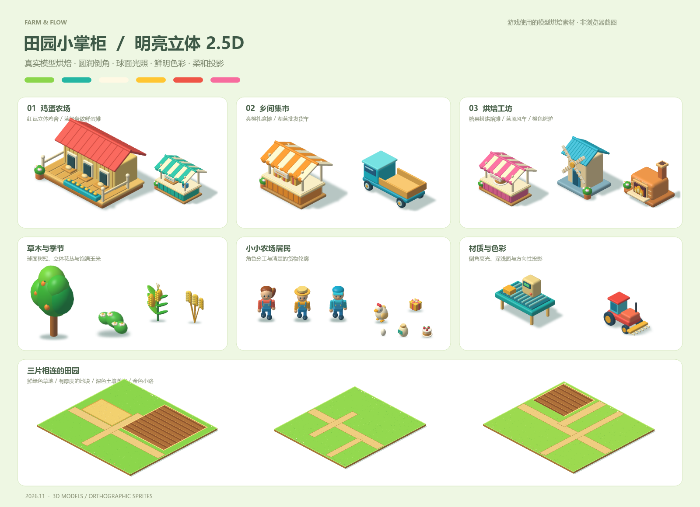

# 田园小掌柜 · Web Farm

**版本：0.3.3（紧凑地图与 2.5D 美术）** · Phaser + TypeScript + Vite

一个可以在浏览器里玩的农场经营小游戏：走位收割、背包搬运、喂鸡卖蛋，再逐步雇佣员工、开设集市和烘焙工坊。

[在线游玩](https://zhaocai7.cn/games/farm/) · [更新记录](CHANGELOG.md) · [架构说明](docs/architecture.md)



新版采用鲜明、圆润的立体 2.5D 风格：主要设施、角色、植物、车辆和货物由三维模型正交烘焙，具有倒角、明暗面和柔和投影。上图为游戏使用的素材样张，非浏览器实机截图；设计与验证状态见 [美术风格说明](docs/art-direction.md)。


上图使用实际素材与地图坐标离线合成，展示三地相邻布局。

## 玩法

- **鸡蛋农场**：收玉米、喂鸡、搬蛋上架，雇佣收割小队和店员，购买收割机。
- **乡间集市**：包装鸡蛋礼盒，开设礼盒摊，装满批发货车，再招聘包装工。
- **烘焙工坊**：种小麦、磨面粉，将面粉与第一章的鸡蛋加工成蛋糕。
- **自动化经营**：员工跨区供货，可分别招聘运输、加工和收款岗位；ATM 余额可直接用于建设。
- **扩建产能**：玉米与鸡舍各有三档升级，真实产出、仓容、背包及运输批次随升级增长。
- **乡间订单**：普通采购、混合商品、四分钟加急单；角色可亲自交货，已有配送岗位协助。交货后在订单板领取货款，再选下一单。
- **加工与销售**：七处设施各两档提速，最高基础速度的两倍；经营面板显示缺料、成品积压、库存、累计产销和满负荷效率。
- **物流调度**：均衡经营、订单优先、加工优先三种策略，七类供货库存保底；员工按交货区域或专岗分工，精确预留货物和目标仓位。
- **运输推车**：十一名运输 / 收割员工各两档推车，真实增加容量、目标批次、移动和装卸速度，画面显示推车及货物数量。
- **产能瓶颈**：滚动记录最近 60 秒实际产出、消耗、收入、开工率和等待时间，结合上游库存判断生产或配送瓶颈。

## 操作

| 操作 | 方法 |
| --- | --- |
| 移动 | WASD、方向键或右下摇杆；普通视角也可拖动地面生成浮动摇杆 |
| 自动寻路 | 点击地面；点击左上目标卡前往建议位置 |
| 收割、投料、供货、收钱 | 走近对应资源或地面交互区自动工作 |
| 招聘、产能和加工升级 | 右上「经营」面板的员工、原料、加工分类 |
| 配送策略、库存保底、员工分工、购买推车 | 经营 → 物流调度 |
| 实际产能、开工率、瓶颈建议 | 经营 → 产能统计 |
| 接单、查看交货进度、领取订单货款 | 左上目标卡下面的「订单」按钮 |
| 区域导航 | 「区域」选择目的地，角色自动步行前往 |
| 缩放 | 右侧 ＋ / − 或鼠标滚轮，最远限制 57% |
| 查看其他区域 | 「总览」后拖动地图；「跟随」恢复角色视角 |
| 暂停 | 右上暂停按钮 |

进度自动保存在当前浏览器，切换后台会暂停。不同域名、浏览器与设备分别保存进度，当前版本不结算离线收益。

## 开发

建议使用 Node.js 24。依赖版本已固定在 `pnpm-lock.yaml`。

```sh
pnpm install --frozen-lockfile
pnpm run dev
```

开发服务默认地址为 `http://127.0.0.1:8792/`。端口被本地预览占用时，应先停止对应服务。

```sh
pnpm test
pnpm run build
```

当前包含 58 项检查，覆盖交易、库存和资金守恒、三章成长、员工自动化、订单交付与加急、加工提速、配送预留与保底、分工切换、推车的实际批次和移动速度、产能统计、存档迁移与缩放下限。

## 本地新内容快速测试

正常进度从 `http://127.0.0.1:8792/` 继续。要直接体验三章完成后的物流调度，可额外启动独立开发服务：

Windows 可直接双击 `启动新内容试玩.cmd`；它在独立端口启动本地服务并打开检查点。

```sh
node node_modules/vite/bin/vite.js --host 127.0.0.1 --port 8793 --strictPort
```

打开 `http://127.0.0.1:8793/verification/playtest.html?checkpoint=dispatch`。这是由正常模拟生成的三章检查点，含可用于购买推车的余额和一分钟经营样本，关闭正式存档写入；刷新后恢复检查点。生成器为 `verification/generate-dispatch.mjs`。`checkpoint=dispatch_carts` 可查看五名员工已购买推车、运蛋员专供烤炉及混合订单的状态。

订单一次承接一单，普通单不限时；加急单计时只在游戏运行时推进，四分钟内备齐会保留奖金，稍后领奖也不丢失。超时只取消奖金，已交货物继续保留。订单规模每五单增长一档，最高五档。升级不会赠送原料，按相同比例保留正在进行的加工进度。旧存档会先在浏览器中留存原始备份，再迁移为 `farm-v3.4`，保留已有订单与在途货物。

库存保底是优先补货目标，设施继续正常消耗库存；订单领取原料时为其他设施的保底缺口留出原料。员工的区域以交货地点划分，取货可跨区。调整分工后先完成已装货的任务；目标被手动补满或订单已结算时，员工把货物运回原来源。推车基础价格 $180，第二档 $400，分别将基础容量和目标批次提高到 2 / 3 倍，移速 +10% / +20%，装卸 +50% / +100%；实际批次仍受货源与目标余量限制。

0.3.3 将烘焙工坊移到农场南侧，集市保留在东侧，南侧通路连接三个区域。鸡蛋送往烤炉的寻路距离约 23.2 米，比旧布局至少缩短 42%。旧存档自动迁移位置并保留资金、货物、订单、员工配送任务和生产进度。发布记录见 verification/deployed-0.3.3.md。

## 直接试玩与部署

仓库保留当前 `dist/` 构建产物。安装 Node.js 后，无需安装前端依赖即可运行：

```sh
node server.mjs
```

Windows 也可双击 `启动游戏.cmd`。服务仅监听本机回环地址，默认端口 8792；手动启动时可用 `FARM_PORT` 环境变量更换端口。

部署时把 `dist/` 内的文件放入静态网站目录。资源路径为相对路径，支持 `/games/farm/` 这样的子目录。构建包含 IIS 的 `web.config`，无需将源码或依赖目录上传到网站。

## 工程结构

```text
src/domain/         规则、生产、寻路、员工、经济与存档校验
src/content/        地图与数值配置
src/rendering/      Phaser 场景、投影、纹理和镜头
src/input/          键盘、指针与摇杆
src/presentation/   DOM HUD 与经营面板
src/platform/       浏览器存储与音效适配
public/             第三方许可与 IIS 配置
verification/       可复现的测试快照、生成器与开发试玩入口
tests/              自动检查
dist/               当前可部署构建
```

开发试玩入口 `verification/playtest.html?checkpoint=expanded` 需通过 Vite 服务打开，使用生成的测试快照，并关闭正式存档写入。

模拟层不依赖 Phaser 或 DOM，为后续 Unity、微信端适配保留边界；当前仍是网页版本。详细结构见 [架构说明](docs/architecture.md)。

## 第三方依赖

Phaser 3.90.0 使用 MIT 许可，许可原文保存在 [public/phaser-LICENSE.txt](public/phaser-LICENSE.txt)。游戏主要图像由原创程序三维模型烘焙，地表与界面由代码绘制。模型与渲染生成器见 tools/render_volume_assets.py。参考视频、分析原件、历史备份、个人验证记录和依赖安装目录不包含在仓库中。
