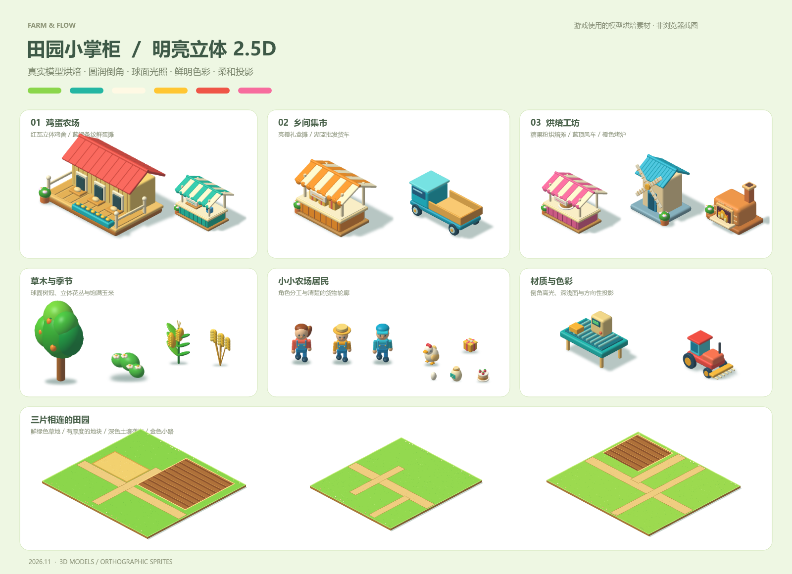
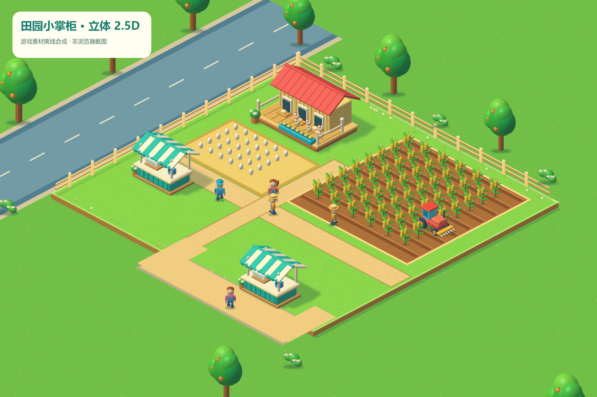

# 田园小掌柜 · 明亮立体 2.5D

2026-11-07 · 0.3.2 本地美术更新

风格采用圆润、鲜明的休闲经营游戏造型。建筑具有坡屋顶、厚实台面、圆角立柱和倒角边缘；树冠与角色具有连续的球面明暗。光源来自左上方，建筑以方向性柔和投影接地，角色和植物使用小范围接地阴影。

素材样张使用游戏实际加载的图像。场景图按游戏投影、位置、尺寸和锚点离线合成，用于检查构图与素材关系；两图均不是浏览器实机截图。

## 立体形体

主要图像来自原创三维几何模型：圆角长方体、球体、圆柱、坡屋顶与组合结构。采用正交投影、深度缓冲、插值法线、定向光照、倒角高光和柔和阴影渲染，再烘焙为透明图像。

67 张烘焙图像包含：

- 鸡舍、鲜蛋摊、礼盒摊、烘焙摊、磨坊、烤炉、包装台和 ATM。
- 果树、花丛、玉米、小麦与小鸡。
- 货车、收割机和四种颜色的汽车。
- 鸡蛋、玉米、礼盒、面粉、蛋糕、小麦与现金。
- 五类角色，每类四个朝向、两帧行走姿态，共 40 张角色图像。

角色头部、帽子和身体使用更饱满的比例。鸡舍前侧保留小鸡活动区；视觉锚点随新造型重新核对。地块边缘增加土层侧面和亮色草皮边，作物地面使用深棕垄沟，路径采用金黄色。

## 配色

| 用途 | 颜色 |
| --- | --- |
| 场景外部草地 | #72bf47 |
| 农田草皮 | #8bd64b |
| 叶片高光 | #b7ee6d |
| 主要操作与设施 | #19a58d / #24b6a3 |
| 屋顶 | #ef5547 |
| 作物、金币与重点 | #ffc632 |
| 烘焙摊 | #f76c9e |
| 文字 | #24545a |
| 界面底色 | #fffbed |

界面保留简洁布局，采用白色高光、绿色底边阴影和圆润按钮，统一到立体场景的材质语言。详细经营信息仍在面板中展开，中央留给游戏。

## 资源与实现

- 模型与软件渲染生成器：tools/render_volume_assets.py，需要 Python 3、NumPy、Pillow。
- 两个 2048 × 2048 图集：src/assets/volume-atlas-0.png 和 volume-atlas-1.png。
- 图集坐标：src/content/volume-art.json。
- src/rendering/volumeArt.ts 在 Phaser preload 阶段加载图集，绘制时保留原贴图逻辑尺寸与锚点。
- verification/render-art.mjs 导出素材样张与离线场景预览，需要 Node、TypeScript 和 @napi-rs/canvas。
- 美术保留经营数值、57% 缩放下限与操作方式；0.3.3 同步调整地图边界与位置，存档迁移为 farm-v3.4。

生成时保留逐张图像在本地 verification/volume-render 目录；正式游戏只加载两张图集；提取出所需纹理后释放临时图集，减少重复占用。Vite 打包后使用相对资源地址，支持本地试玩和 /games/farm/ 子目录。

## 验证状态

图集与全部纹理已离线绘制并目视核对。TypeScript 与正式构建通过，58 项玩法、地图与存档测试全部通过。浏览器实机画面、实际操作和手机遮挡仍待验收：当前电脑控制工具不支持本机浏览器的 URL 策略校验。本次美术已随 0.3.3 于 2026-11-07 发布，两个正式域名共 16 项入口与资源哈希检查通过。

前一版源文件备份位于 backups/art-volume-20261107/。
