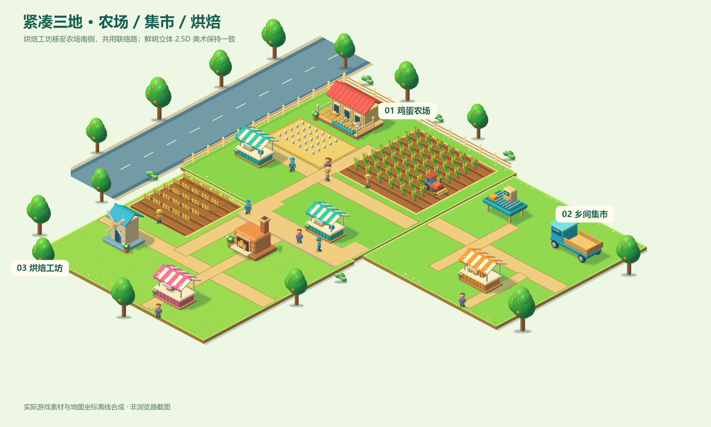

# 紧凑地图 · 0.3.3

鸡蛋农场保留原位置；乡间集市位于东侧；烘焙工坊移到南侧，原点由 (42, 1) 改为 (7, 19)。三个地块形成 L 形，南侧通路连接农场和烘焙工坊，区域导航及经营面板使用当前内容坐标。

从鸡舍取蛋点到烤炉投料点，旧版实际寻路约 40.2 米，新版约 23.2 米，缩短约 42%。麦田、磨坊、烤炉、摊位、员工、货物堆和装饰同步移动。东南空缺区域不可通行，未购买地块仍受解锁限制。

旧存档先验证经济守恒；保留库存、生产时钟、订单、资金、员工任务和在途货物，迁移烘焙区域位置，重新计算行走路线。旧 v3.3 原文备份在浏览器 farm-and-flow.save.v1.backup.v3.3-before-compact-map；当前存档版本为 farm-v3.4。

寻路起点选择可直接到达的半米网格锚点，拐角走到节点再转弯，避免在 L 形凹角切入地图外后卡住。58 项测试已通过。

此图为离线布局验收，浏览器画面和输入验收仍待完成。
